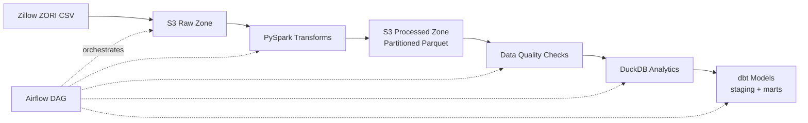

# PySpark Rental Market ETL Pipeline

Production-style ETL pipeline processing Zillow ZORI (Observed Rent Index) data with PySpark window functions, configurable data quality checks, and Airflow orchestration.

## Architecture



## Key Features

- **Window functions** — month-over-month rent change via `lag()`, state-level ranking via `rank()`
- **Data quality framework** — configurable null %, row count, range, and uniqueness checks with warn/fail severity
- **Partitioned Parquet** — output partitioned by `(StateName, year)` with Snappy compression
- **dbt transformation layer** — `dbt-duckdb` staging view + two mart tables over the loaded `zori_rent` table, with column-level and singular tests
- **Airflow orchestration** — `@weekly` DAG using TaskFlow API: download (stub, see below) → transform → DQ → DuckDB load + `dbt run` / `dbt test`
- **CI/CD** — parallel GitHub Actions for lint (ruff) and test (pytest + PySpark)

## Tech Stack

Python 3.10+ · PySpark 3.5 · Apache Airflow 2.x · AWS S3 (boto3) · DuckDB · dbt-duckdb · pytest · ruff · GitHub Actions

## Quick Start

```bash
git clone https://github.com/jairajsaraf/rentals-data-pipeline.git
cd rentals-data-pipeline
python -m venv .venv && source .venv/bin/activate
pip install -r requirements.lock

# Run tests
make test

# Lint
make lint

# Run transforms locally (needs the input CSV, see "Input data" below)
make run-local

# Full local run: transform -> load DuckDB -> dbt run -> dbt test
make pipeline-local
```

> **Requires:** Java 11+ (PySpark dependency). CI uses Java 11; local tests were run on Java 21. On Ubuntu 24.04: `sudo apt-get install -y openjdk-21-jre-headless`.
>
> **Windows:** use WSL2 (Ubuntu). The Makefile assumes a POSIX shell and has not been run on native Windows; CI runs on `ubuntu-latest`.

### Input data

No sample data ships with the repo (`data/` is gitignored). The Airflow `download_data` task is a **stub**: it logs the configured S3 raw path and returns it, but does not download anything (`# TODO: implement actual download` in `dags/rental_pipeline_dag.py`). Fetch the Zillow ZORI ZIP-level CSV yourself and place it where `config/pipeline.yaml` expects it:

- **Local runs** (`make run-local`, `make pipeline-local`): `data/raw/Zip_zori_uc_sfrcondomfr_sm_month.csv` (`local.raw_path`)
- **Airflow / S3 runs**: the DAG reads from `s3.raw_path`, so the CSV would need to be uploaded there. The Airflow/S3 path is not exercised by CI or the tests.

Without that file, `make run-local` fails with `PATH_NOT_FOUND` on the raw CSV path.

### Dependencies

`requirements.txt` lists the top-level, exact-pinned packages (the intent). `requirements.lock` is the fully resolved set of every transitive dependency for Python 3.10 and up, produced by `uv pip compile` ([uv](https://docs.astral.sh/uv/) is a tool, not a project dependency). Install from the lock. To regenerate after editing `requirements.txt`:

```bash
uv pip compile --universal --python-version 3.10 requirements.txt -o requirements.lock
```

Installing `requirements.txt` directly is not supported: `dbt-core==1.8.0` requires `protobuf<5`, while newer unpinned `dbt-adapters` releases require `protobuf>=5`, and `pip` fails with `ResolutionImpossible`. The lock resolves this (`dbt-adapters==1.9.0`, `protobuf==4.25.9`).

## Pipeline Details

### Transforms (`jobs/transform.py`)

| Step | Function | Description |
|------|----------|-------------|
| 1 | `enforce_schema` | Select columns, cast types (dynamic date column detection) |
| 2 | `unpivot_monthly` | Wide → long format via `stack()` |
| 3 | `clean_nulls` | Drop null `median_rent` rows |
| 4 | `deduplicate` | Remove dupes on `(RegionID, month)` |
| 5 | `add_mom_change` | MoM % rent change — `lag()` over `partitionBy(RegionID)` |
| 6 | `add_state_rank` | Rent rank — `rank()` over `partitionBy(StateName, month)` |

### Data Quality (`jobs/data_quality.py`)

Configurable checks driven by `config/pipeline.yaml`:

- **Null %** — `median_rent` null fraction <= 10%
- **Row count** — minimum 100 rows
- **Range** — rent values in [0, 50000]
- **Uniqueness** — no duplicates on `(RegionID, month)`

Checks use a `DataQualityCheck` dataclass with `warn`/`fail` severity. Failed checks raise `DataQualityError`.

### Partitioning

Output Parquet is partitioned by `StateName` and `year` (extracted from `month`), enabling efficient queries by geography and time.

### DuckDB load (`jobs/load_duckdb.py`)

CLI helper that creates or replaces the `zori_rent` table in a local DuckDB file from the partitioned Parquet output. It runs the same `CREATE OR REPLACE TABLE ... read_parquet` load as the Airflow task (a separate copy of that code), so `make pipeline-local` needs no scheduler:

```bash
python jobs/load_duckdb.py --parquet data/processed/zori/ --db data/rental_market.duckdb
```

### dbt layer (`dbt/`)

Profile `rental_market` (target `dev`) runs on `dbt-duckdb` against `data/rental_market.duckdb`, reading `main.zori_rent` as its source.

| Model | Materialization | Description |
|-------|-----------------|-------------|
| `stg_zori_rent` | view | Typed, snake_cased staging over `zori_rent` |
| `mart_state_rent_summary` | table | State x month rent aggregates |
| `mart_rent_trends` | table | Per-region monthly rent with a trailing 12-month rolling average |

Tests: column-level `not_null` in `dbt/models/**/*.yml`, plus singular tests in `dbt/tests/` (`assert_no_future_months.sql`, `assert_unique_region_month.sql`). Downstream queries should read the `mart_*` tables rather than raw `zori_rent`.

```bash
make dbt-run    # build models
make dbt-test   # run dbt tests
make dbt-docs   # generate and serve docs
```

## Project Structure

```
├── dags/
│   └── rental_pipeline_dag.py    # Airflow DAG (TaskFlow API)
├── jobs/
│   ├── transform.py              # PySpark transforms (pure functions)
│   ├── data_quality.py           # DQ assertion framework
│   ├── io_utils.py               # CSV/Parquet I/O + config loader
│   └── load_duckdb.py            # Parquet -> DuckDB zori_rent loader (CLI)
├── dbt/
│   ├── models/
│   │   ├── staging/              # stg_zori_rent (view) + source definition
│   │   └── mart/                 # mart_state_rent_summary, mart_rent_trends (tables)
│   ├── tests/                    # singular tests (no future months, unique region-month)
│   └── profiles.yml              # dbt-duckdb profile
├── tests/
│   ├── conftest.py               # SparkSession + sample data fixtures
│   ├── test_transform.py         # 6 transform tests
│   └── test_data_quality.py      # 10 DQ tests
├── config/
│   └── pipeline.yaml             # S3 paths, partition keys, DQ thresholds
├── .github/workflows/ci.yml      # Parallel lint + test CI
├── Makefile                       # test, lint, run-local, dbt-*, pipeline-local, clean
├── requirements.txt               # Top-level dependencies (exact pins)
└── requirements.lock              # Locked: full transitive set (uv), used by CI
```
